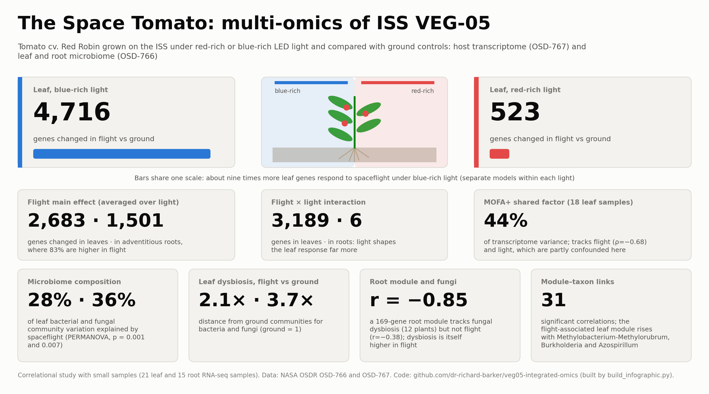

# Integrated Transcriptome-Microbiome Analysis of ISS VEG-05 Tomatoes



🌐 **Live site:** https://dr-richard-barker.github.io/veg05-integrated-omics/

## Overview

Complete analysis pipeline for an integrated multi-omics study of dwarf tomato (*Solanum lycopersicum* cv. Red Robin) grown aboard the International Space Station (ISS) during the VEG-05 experiment. The experiment compared two lighting regimes (red-rich and blue-rich) with matched ground controls at Kennedy Space Center.

## Data Sources

| Dataset | OSDR Accession | Description |
|---------|---------------|-------------|
| RNA-seq | OSD-767 | Host transcriptome (Leaf, Adv-Root) |
| Microbiome | OSD-766 | 16S rRNA + ITS amplicon sequencing |

## Pipeline

| Step | Script | Description |
|------|--------|-------------|
| 0 | `scripts/00_download_data.py` | Download processed RNA-seq data and microbiome FASTQ from the OSDR API |
| 1 | `scripts/01_parse_metadata.py` | Parse ISA-Tab metadata; build the RNA-seq ↔ microbiome sample crosswalk |
| 2 | `scripts/02_microbiome_dada2.R` | DADA2 amplicon processing (16S + ITS) |
| 3 | `scripts/03_rnaseq_deseq2.R` | DESeq2 differential expression |
| 4 | `scripts/04_community_health.R` | Alpha/beta diversity, PERMANOVA, dysbiosis index, ALDEx2 |
| 5 | `scripts/05_functional_prediction.R` | FAPROTAX (via `scripts/faprotax_collapse.py`, custom) and FUNGuild |
| 6 | `scripts/06_wgcna.R` | WGCNA co-expression networks |
| 7 | `scripts/07_integration_mofa.R` | MOFA+ multi-omics integration (leaf) |
| 8 | `scripts/08_correlation_networks.R` | Module–taxon correlation networks |
| 9 | `scripts/09_directionality.R` | GO enrichment of modules; directionality inference |
| 10 | `scripts/10_figures_main.R` | Main figures 2–7 |
| 11 | `scripts/11_figures_supplementary.R` | Supplementary figures S1–S7 |
| 12 | `scripts/12_export_tables.R` | Supplementary tables S1–S10 |
| — | `build_fig1_schematic.py` | Figure 1 (study-design schematic) |
| — | `build_module_annotations_and_fig4.py`, `fix_fig4_wgcna.py`, `fix_fig6_module_taxon.py` | Module GO labels (`results/module_annotations.tsv`); redrawn Figures 4 and 6 |
| — | `build_manuscript_figures.py` | Builds `manuscript_with_figures.md` and `.docx` from `manuscript_draft.md` |

The R and Python pipeline scripts were run in an analysis sandbox and hard-code
`REPO_ROOT <- "/mnt/shared-workspace/veg05-integrated-omics"`. They read inputs from
`data/` and write to `results/` under that root; neither directory is tracked here.
The outputs used in the manuscript were copied into the top-level folders listed
below, so the scripts are not runnable from this repository without editing those paths.

## Key Results

### Microbiome
- **16S**: 348 bacterial ASVs (after chloroplast/mitochondria removal), 142 samples, 3,558,814 reads
- **ITS**: 77 fungal ASVs, 141 samples, 160,316 reads
- **PERMANOVA (16S leaf)**: R²=0.42, F=4.02, p=0.001 — spaceflight significantly reshapes leaf bacterial communities
- **Dysbiosis (16S leaf)**: Flight 2.06±0.99 vs Ground 1.00±0.47
- **Dysbiosis (ITS leaf)**: Flight 3.64±2.78 vs Ground 1.00±0.24

### Transcriptome
- **Leaf**: 19,844 genes, 21 samples. Flight×Light interaction: 3,189 DEGs
- **Adv-Root**: 20,875 genes, 15 samples. Flight effect: 896 DEGs (87% upregulated)
- **Key finding**: Spaceflight response under blue light (4,716 DEGs) >> red light (523 DEGs) in leaf

### Integration
- **WGCNA**: Leaf 13 modules, Adv-Root 17 modules
- **Key module**: Adv-Root black (169 genes) — microbe-driven (r=−0.85 with ITS dysbiosis, NOT correlated with flight)
- **MOFA+**: 5 factors, 21 samples, 3 views. Factor 1 captures flight (ρ=−0.76, padj=0.001), explains 48% transcriptome variance
- **Module-taxon correlations**: 29 significant (BH padj<0.05), linking flight modules to Methylobacterium, Burkholderia, Azospirillum
- **GO enrichment**: 80 terms (Leaf), 96 terms (Adv-Root). Photosynthesis, oxidative stress, ribosome

### Functional Prediction
- **FAPROTAX**: 29 functions, dominated by aerobic chemoheterotrophy, nitrogen fixation, methanotrophy
- **FUNGuild**: Saprotrophs (11 ASVs), Plant Pathogens (2 ASVs: Fusarium spp.)

## Repository Structure

```
veg05-integrated-omics/
├── scripts/                     # Analysis pipeline, steps 00–12 (see Pipeline table)
├── microbiome/                  # DADA2 taxonomy and read tracking (16S, ITS)
│   ├── community_health/        # Alpha/beta diversity, PERMANOVA, dysbiosis, ALDEx2
│   └── functional/              # FAPROTAX and FUNGuild outputs
├── rnaseq/                      # DESeq2 DEG tables and summary, sample-distance QC
│   ├── go_enrichment/           # GO enrichment of WGCNA modules
│   ├── wgcna_Leaf/              # Module–trait correlations, hub genes
│   └── wgcna_Adv-Root/
├── integration/                 # MOFA+ model, factor values, variance, weights
│   └── networks/                # Module–taxon correlations, directionality
├── results/                     # module_annotations.tsv (module GO labels)
├── figures/                     # Figures 1–7 and S1–S7 (PDF, PNG, SVG)
├── supplementary_tables/        # Tables S1–S10 (CSV)
├── manuscript/latex/            # LaTeX manuscript (main.tex, references.bib) + figure copies
├── manuscript_draft.md          # Markdown manuscript (source for the two files below)
├── manuscript_with_figures.md   # Draft with figures embedded
├── manuscript_with_figures.docx
├── build_*.py, fix_*.py         # Figure and manuscript builders (see Pipeline table)
├── docs/                        # GitHub Pages site and compiled manuscript PDF
├── execution_trace/             # Original analysis plan and agent notebook
├── COMPARISON_with_SA_integration.md
└── environment.yml, requirements.txt, renv.lock, sessionInfo.txt
```

## Software Versions

- R 4.4.2, Bioconductor 3.20
- DADA2 1.34.0, phyloseq 1.50.0, DESeq2 1.46.0, WGCNA 1.74, MOFA2 1.16.0
- ALDEx2 1.38.0, clusterProfiler 4.14.0, vegan 2.7-5
- SILVA 138.2, UNITE v7 (Oct 2017), FAPROTAX v1.2
- Python 3.12, mofapy2 0.7.4, cutadapt

## Limitations

1. Small sample sizes (n=21 leaf, n=15 root for RNA-seq)
2. 16S leaf samples have very low bacterial reads after host DNA removal (median 89)
3. ITS dataset has uneven group representation (some flight groups n=1-2)
4. UNITE v7 used instead of v10 (Plutof.ut.ee inaccessible from analysis environment)
5. FAPROTAX collapse implemented in custom Python (collapse_table.py unavailable for download)
6. FUNGuild used manual genus-level assignment (script database incompatible)
7. Study is correlational; causal relationships require experimental validation

## License

MIT License. See LICENSE file for details.

## Citation

If using this code or data, please cite:
- NASA OSDR: OSD-766, OSD-767
- This repository: DOI via Zenodo — badge pre-wired to repo id 1287757020; activates on Zenodo link + release:
  [](https://zenodo.org/badge/latestdoi/1287757020)
