# Spaceflight alters the tomato phyllosphere and rhizosphere microbiome in a light-dependent manner: a multi-omics integration of ISS VEG-05

## Manuscript draft for npj Microgravity

---

## Abstract

Spaceflight imposes unique stressors on plant-microbe interactions, but the coordinated responses of host transcriptomes and associated microbiomes remain poorly characterized. We analyzed tomato (*Solanum lycopersicum* cv. Red Robin) grown aboard the International Space Station (ISS) as part of the VEG-05 experiment, integrating 16S rRNA and ITS amplicon sequencing (OSD-766) with host transcriptomics (OSD-767) across two tissues (leaf, adventitious root) and two light treatments (red-rich vs. blue-rich LED). DADA2 processing yielded 348 bacterial and 77 fungal ASVs from 142 and 141 samples respectively. Leaf bacterial community composition differed among flight and light groups (PERMANOVA R²=0.42 for the full flight × light model, p=0.001), and flight samples had higher bacterial alpha diversity (Observed ASVs: Flight 17.8–25.8 vs. Ground 10.0–15.2). The spaceflight transcriptional response was strongly light-dependent: under blue light, 4,716 differentially expressed genes (DEGs) were detected in leaves versus only 523 under red light. WGCNA identified a 169-gene adventitious root module correlated with fungal dysbiosis (r=−0.85, padj=0.009) but not with flight status (r=−0.38, padj=0.32), representing a microbe-driven host transcriptional signature independent of the direct spaceflight stimulus. MOFA+ integration across three omics layers confirmed a dominant flight-associated factor (48% transcriptome variance) **[TODO: the MOFA+ microbiome views were built from mismatched samples; re-run before comparing bacterial and fungal responses]**. The most abundant FAPROTAX-predicted bacterial functions were aerobic chemoheterotrophy, nitrogen fixation, dark hydrogen oxidation and methanol oxidation. These findings demonstrate that spaceflight restructures plant-associated microbiomes in a tissue- and light-specific manner, with implications for crop production systems in long-duration space missions.

---

## Introduction

Plant-associated microbiomes play critical roles in nutrient acquisition, pathogen protection, and stress tolerance [1]. In the context of spaceflight, these interactions take on added significance: crops grown in bioregenerative life support systems must maintain productive plant-microbe partnerships under conditions of microgravity, altered fluid dynamics, elevated radiation, and controlled-environment lighting [2]. The VEG-05 experiment aboard the International Space Station (ISS) provided a unique opportunity to study these interactions in tomato (*Solanum lycopersicum*), a candidate crop for long-duration missions [3, 23].

Spaceflight has been shown to alter microbial community composition, gene expression, and virulence in pure culture systems [4,5]. However, the coordinated response of host plants and their associated microbiomes to the spaceflight environment remains largely unexplored. Multi-omics integration approaches such as MOFA+ (Multi-Omics Factor Analysis) [6] and WGCNA (Weighted Gene Co-expression Network Analysis) [7] offer powerful frameworks for identifying coordinated variation across biological layers, but have not been applied to spaceflight plant-microbiome studies.

Here we present an integrated analysis of the VEG-05 tomato microbiome (16S rRNA and ITS amplicon sequencing, OSD-766) and host transcriptome (RNA-seq, OSD-767) (Fig. 1). We characterize community health through diversity metrics and a dysbiosis index, identify co-expression modules associated with microbial changes, and infer the directionality of host-microbe interactions using a framework that distinguishes host-driven, microbe-driven, and co-regulated responses.

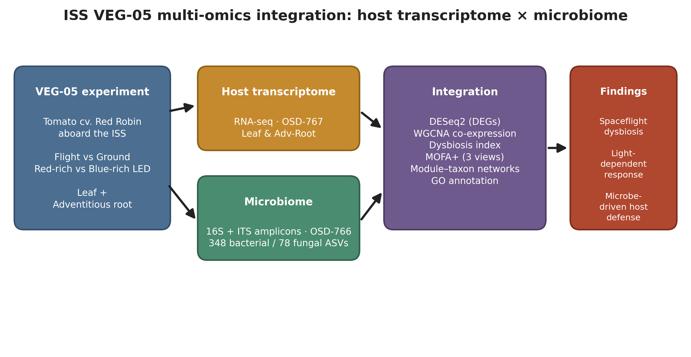

***Figure 1. Study design and analysis overview.** The ISS VEG-05 experiment (tomato cv. Red Robin; Flight vs Ground; red-rich vs blue-rich LED; leaf and adventitious root) feeds two data streams — host transcriptome (OSD-767) and microbiome (OSD-766) — that are combined through DESeq2, WGCNA, a dysbiosis index, MOFA+, and module–taxon networks.*

---

## Methods

### Data acquisition and metadata

Raw sequencing data and metadata were obtained from NASA's Open Science Data Repository (OSDR): OSD-766 (microbiome amplicon sequencing [3]) and OSD-767 (host RNA-seq [23]). The VEG-05 experiment grew tomato cv. Red Robin aboard the ISS under red-rich (90% red:10% blue) or blue-rich (50% red:50% blue) LED lighting, with ground controls at Kennedy Space Center. Metadata were parsed from ISA-Tab format, and a crosswalk table linking microbiome and RNA-seq samples by plant ID, flight status, light treatment, and tissue was constructed.

### Microbiome amplicon processing

16S rRNA (V4 region, 515F/806R primers) and ITS2 (ITS3F/ITS4 primers) reads were processed using DADA2 v1.34.0 [8] in R. For 16S, primers were already removed; reads were truncated at 240 bp (R1) and 160 bp (R2) with maxEE=2, length-filtered to 200–260 bp, and pooled for denoising. Taxonomy was assigned against SILVA 138.1 [9]. Chloroplast and mitochondrial ASVs were removed prior to community analysis. For ITS, primers were removed with cutadapt [10]; R2 reads were truncated at 180 bp due to quality degradation; taxonomy was assigned against UNITE v7 (October 2017) [11].

### Differential expression analysis

RNA-seq count matrices were analyzed with DESeq2 [12] separately for leaf (21 samples) and adventitious root (15 samples; Table S1). The design model included flight status, light treatment, and their interaction. Each main effect is the effect of one factor averaged over both levels of the other. Log-fold changes were shrunk with ashr [14] for the main effects and the within-light contrasts, and with apeglm [13] for the interaction term. DEGs were defined as padj < 0.05 and |log2FC| ≥ 1.

### Community health metrics

Alpha diversity (Observed ASVs, Shannon index) was computed on unfiltered data using phyloseq [15]. Beta diversity was assessed via Bray-Curtis dissimilarity and PERMANOVA (999 permutations) using vegan [16]. A dysbiosis index was calculated for each flight sample as its mean Bray-Curtis distance to all ground samples of the same compartment (both light treatments), divided by the mean pairwise distance among those ground samples. Differential abundance testing used ALDEx2 [17] with 128 Monte Carlo instances, requiring both a Benjamini–Hochberg-adjusted Welch p < 0.05 and |effect size| > 1; positive effects are higher in flight.

### WGCNA co-expression networks

WGCNA [7] was applied to variance-stabilized transcriptome data for each tissue separately. Soft-thresholding powers were selected to maximize scale-free fit (Leaf: power=20, R²=0.72; Adv-Root: power=18, R²=0.69). Module eigengenes were correlated (Pearson) with flight status, light treatment, and the 16S/ITS dysbiosis indices of the same plant and tissue. A ground sample's index is its mean Bray-Curtis distance to the other ground samples of its compartment, over the same denominator, so ground indices average 1. Dysbiosis indices exist for 21 (16S) and 18 (ITS) of the 21 leaf samples and for 15 and 12 of the 15 adventitious-root samples; each correlation's p-value uses that number of samples. Hub genes were the 10 genes with the highest module membership (kME) in each module (all kME ≥ 0.86).

### MOFA+ multi-omics integration

MOFA2 [6] was trained on 21 leaf samples with matched data across three views: transcriptome (2,000 most variable genes), 16S (348 ASVs), and ITS (77 ASVs). The model was trained with 5 factors and default priors. Factor-trait correlations were computed using Spearman's rank correlation with BH correction.

### Correlation networks and directionality inference

Bipartite module-taxon networks were constructed by Spearman correlation between WGCNA module eigengenes and ASV relative abundances (prevalence filter >20%, BH correction). GO enrichment of WGCNA modules was performed using clusterProfiler's enricher function [18] with tomato GO annotations from Ensembl Plants (18,479 annotated genes). Directionality was classified as: host-driven (correlated with flight/light but not dysbiosis), microbe-driven (correlated with dysbiosis but not flight/light), or co-regulated (correlated with both).

### Functional prediction

Bacterial functional profiles were predicted using FAPROTAX v1.2 [19] with a custom Python implementation of the collapse algorithm. Fungal ecological guilds were assigned using genus-level lookup tables based on FUNGuild [20] categories.

### Data and code availability

All analysis code is available at https://github.com/dr-richard-barker/veg05-integrated-omics. Raw data are available from NASA OSDR (OSD-766, OSD-767).

---

## Results

### Spaceflight reshapes leaf bacterial communities

DADA2 processing of 16S rRNA reads yielded 544 ASVs from 142 samples (3,558,814 non-chimeric reads, 89.8% retention). After removing chloroplast (38.9% of reads) and mitochondrial (21.5%) sequences, 348 bacterial ASVs remained. ITS processing yielded 77 fungal ASVs from 141 samples (160,316 reads, 15.8% retention).

Bacterial community composition differed among flight and light groups in leaves (PERMANOVA, full flight × light model: R²=0.42, F=4.02, p=0.001, n=21) and adventitious roots (R²=0.33, F=2.93, p=0.001, n=15; Table S4). These R² values are for the whole model, not for spaceflight alone **[TODO: term-wise PERMANOVA]**. In leaves, bacterial alpha diversity was higher in flight samples: Observed ASVs ranged from 17.8–25.8 in flight versus 10.0–15.2 in ground controls (Fig. 2A; Table S3). The Shannon index showed a similar pattern, with flight blue-light samples reaching 2.18 versus 0.80 in ground blue-light controls.

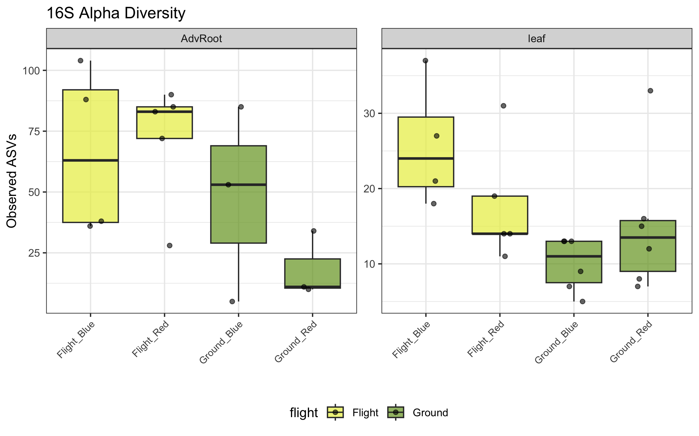

***Figure 2A.** Bacterial (16S) alpha diversity (Observed ASVs) by flight status and light treatment; flight leaves show higher diversity.*

The dysbiosis index quantified community displacement relative to ground controls. Leaf bacterial communities showed a 2.06-fold increase in dysbiosis during flight (2.06 ± 0.99 vs. 1.00 ± 0.47, Fig. 2B). Fungal communities showed even greater displacement (ITS leaf: 3.64 ± 2.78 vs. 1.00 ± 0.24), though the PERMANOVA model was not significant (model R²=0.45, p=0.054). Adventitious root fungal community composition also differed among groups (model R²=0.65, F=8.19, p=0.001).

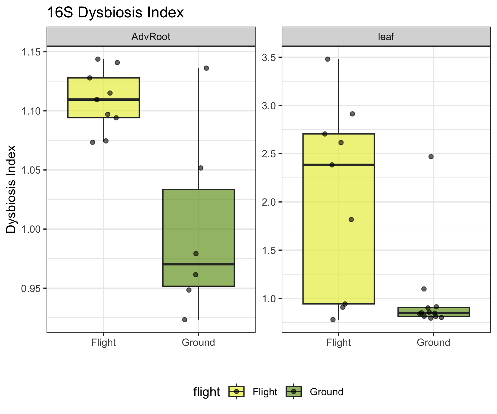

***Figure 2B (16S).** Bacterial dysbiosis index (mean Bray-Curtis distance to ground samples, relative to ground-ground distance); elevated under flight.*

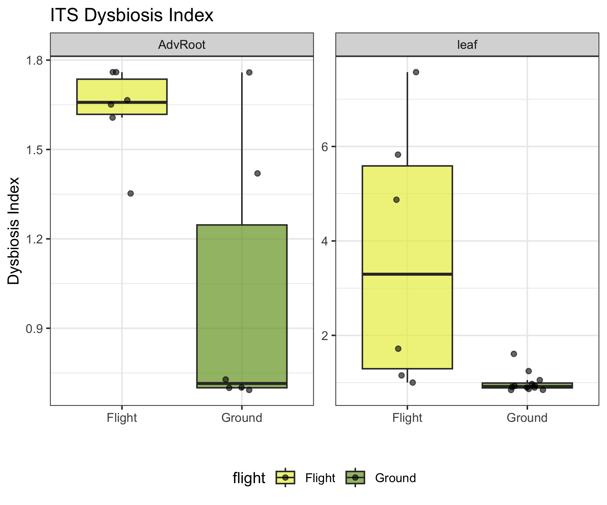

***Figure 2B (ITS).** Fungal dysbiosis index; the largest displacement is in flight leaves.*

ALDEx2 identified few taxa with significant differential abundance under the conservative dual criterion (BH-adjusted p < 0.05 and |effect| > 1), all of them more abundant in flight. In leaf 16S, *Pantoea* (ASV024) was enriched in flight (effect=+1.10). In ITS, *Penicillium citrinum* (ASV003) was enriched in flight leaves (effect=+1.82). In adventitious roots, *Fusarium solani* (ITS ASV006; effect=+1.82) and three bacterial taxa (16S ASV004, *Burkholderia-Caballeronia-Paraburkholderia*, +1.58; ASV021, Rhizobiaceae, +3.25; ASV022, *Dyadobacter*, +2.22) were enriched in flight.

### Spaceflight transcriptional response is light-dependent

DESeq2 analysis revealed a pronounced interaction between spaceflight and light quality (Table S2). In leaves, the flight main effect (the flight effect averaged over the two light treatments) gave 2,683 DEGs (1,368 up, 1,315 down; Fig. 3B). Separate models within each light treatment gave 4,716 DEGs under blue-rich light and 523 under red-rich light (Fig. 3). The formal interaction term identified 3,189 DEGs, confirming that the transcriptional response to spaceflight is strongly modulated by light quality.

In adventitious roots, the flight main effect was predominantly upregulation (1,501 DEGs: 1,245 up, 256 down, 83% upregulated; Fig. 3C), suggesting activation of stress response pathways. The interaction was minimal (6 DEGs after shrinkage), indicating that the root transcriptional response to spaceflight is less light-dependent than the leaf response.

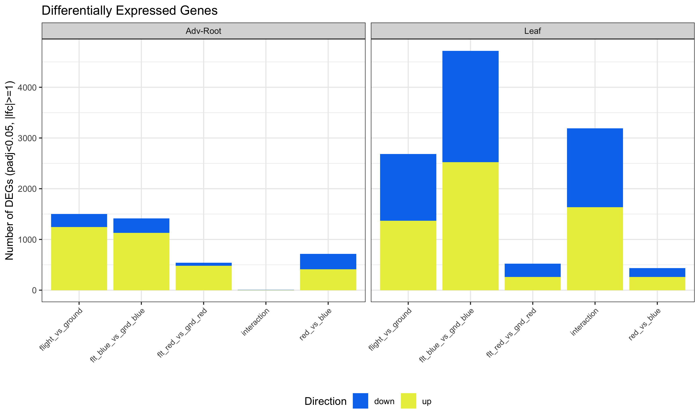

***Figure 3.** DEG summary across tissue × contrast; the leaf blue-light flight response (4,716 DEGs) dwarfs red (523).*

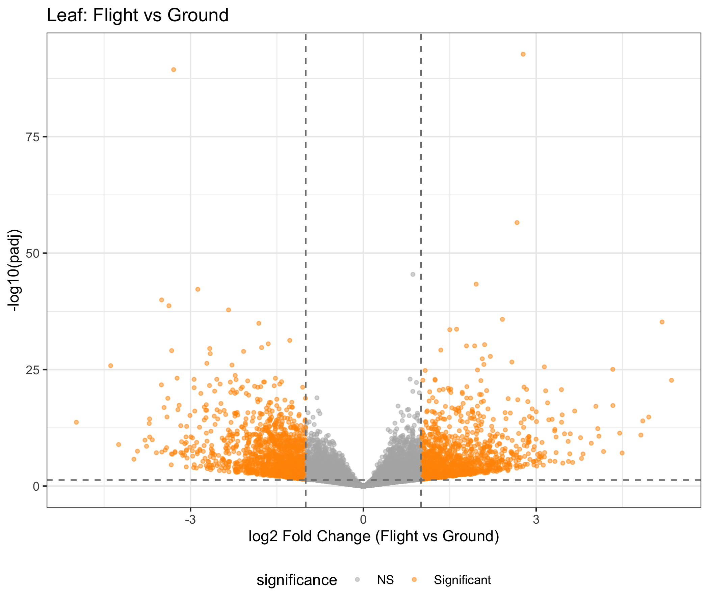

***Figure 3B.** Leaf Flight-vs-Ground volcano (flight main effect of the flight × light model: the flight effect averaged over the two light treatments).*

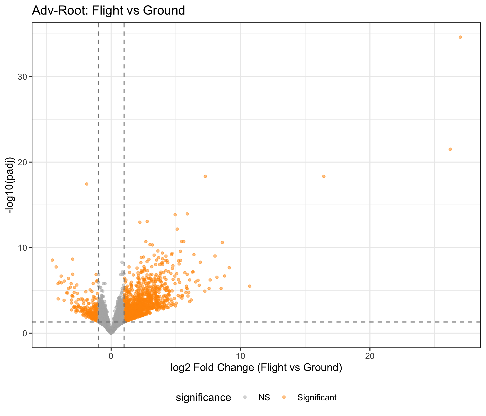

***Figure 3C.** Adventitious-root Flight-vs-Ground volcano (flight main effect, averaged over the two light treatments; predominantly upregulation).*

### WGCNA identifies a microbe-driven host transcriptional module

WGCNA of the leaf transcriptome identified 12 modules plus unassigned genes (power=20; Fig. 4), with the turquoise module (n=2,037 genes) showing the strongest flight correlation (r=+0.73, padj=0.001) and the blue module (n=1,012) showing the strongest anti-correlation (r=−0.79, padj=3×10⁻⁴). Four leaf modules were classified as co-regulated (correlated with both flight and dysbiosis), reflecting the intertwined nature of environmental and microbial signals (Table S5).

In adventitious roots, WGCNA identified 16 modules plus unassigned genes (power=18). The key finding was the black module (n=169 genes), which was strongly correlated with ITS dysbiosis (r=−0.85, padj=0.009, 12 plants) but not with flight status (r=−0.38, padj=0.32). The correlation holds within flight plants (r=−0.87, n=6) and within ground plants (r=−0.75, n=6), although the ITS dysbiosis index is itself higher in flight (r=0.70 with flight status). The green module (n=287; ITS r=−0.72, padj=0.044) was also classified as microbe-driven, and the turquoise module as co-regulated (flight r=+0.72; ITS r=+0.74, padj=0.044). The black module was classified as microbe-driven, representing a host transcriptional response to fungal community changes that is independent of the direct spaceflight stimulus. GO enrichment of the black module itself was limited — its only significantly enriched term was the cellular component "nucleus" — so it is defined here by its microbe-driven trait association rather than by a specific enriched process; the adventitious-root oxidative-stress program was instead concentrated in the larger turquoise module (see below).

GO enrichment analysis of all modules revealed biologically coherent functional signatures (full results in Table S10). In leaves, the black module was enriched for photosynthesis and photosystem genes (p.adj=4.4×10⁻²⁵), while the red module was enriched for RNA binding and protein binding. In adventitious roots, the turquoise module (the largest, n=1,768) was enriched for oxidative stress response (peroxidase activity, p.adj=4.2×10⁻⁹; hydrogen peroxide catabolism, p.adj=1.1×10⁻⁸; glutathione transferase activity, p.adj=3.9×10⁻⁷), consistent with spaceflight-induced oxidative stress.

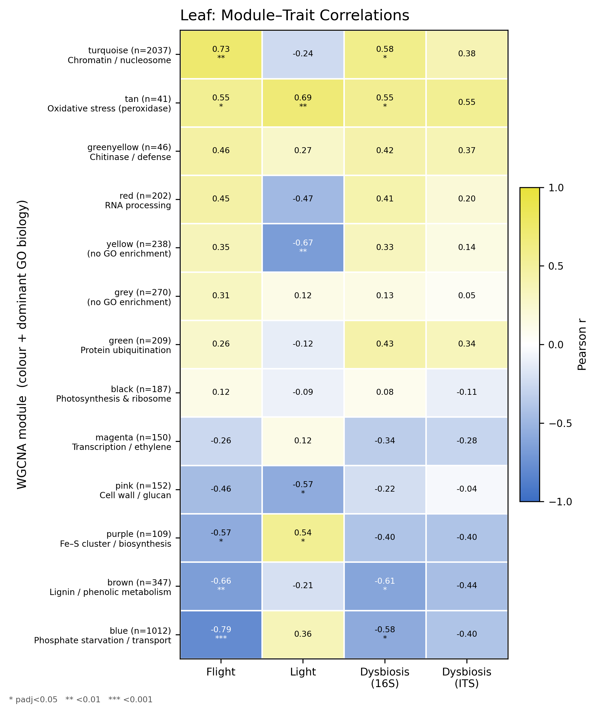

***Figure 4 (Leaf).** WGCNA module–trait correlations (flight, light, 16S/ITS dysbiosis). Each module is labelled with its dominant GO biology (Table 1); cells show Pearson r with significance stars.*

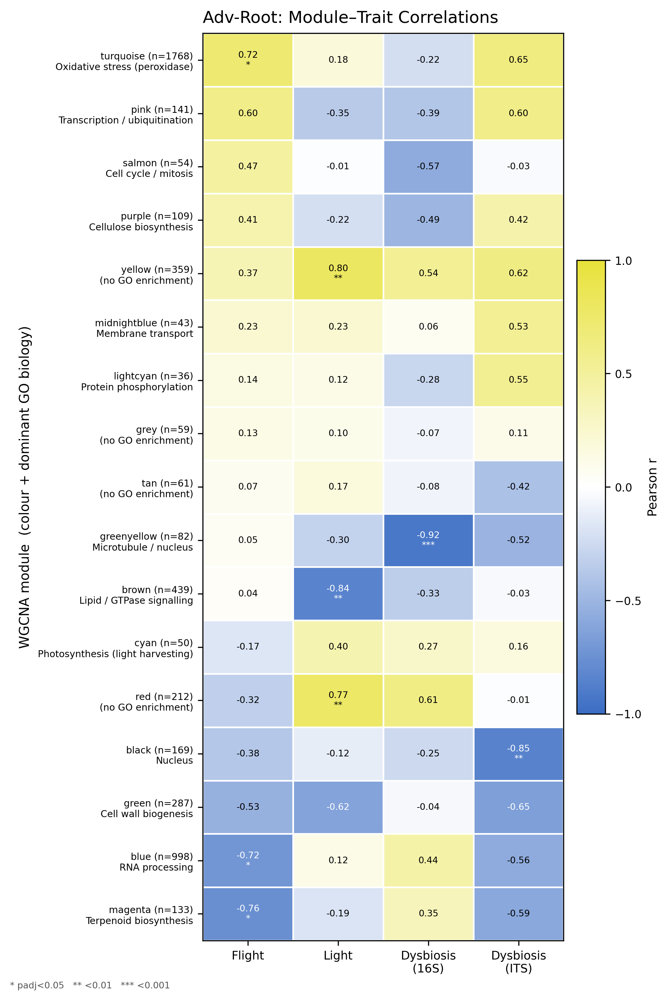

***Figure 4 (Adv-Root).** Module–trait correlations with GO-biology labels (Table 1). The black (nucleus) module tracks ITS dysbiosis (r=−0.85) but not flight; the turquoise (oxidative-stress/peroxidase) module is the largest flight-correlated module.*

### Module functional annotation (GO)

To make the WGCNA module colours interpretable, each module was annotated with its dominant biology from per-module Gene Ontology enrichment (Table 1). These human-readable labels are shown alongside the module colours on the axes of Figs 4 and 6. Modules with no significant enrichment are marked accordingly.

**Table 1. GO-based functional annotation of WGCNA modules.**

| Tissue | Module | GO biology (dominant) | Representative GO terms |
|---|---|---|---|
| Adv-Root | black | Nucleus | nucleus |
| Adv-Root | blue | RNA processing | protein binding; RNA binding; RNA modification |
| Adv-Root | brown | Lipid / GTPase signalling | ATP-dependent diacylglycerol kinase activity; phospholipase C-activati... |
| Adv-Root | cyan | Photosynthesis (light harvesting) | photosynthesis, light harvesting; photosynthesis; photosystem I |
| Adv-Root | green | Cell wall biogenesis | xyloglucan metabolic process; cell wall; xyloglucan:xyloglucosyl trans... |
| Adv-Root | greenyellow | Microtubule / nucleus | microtubule binding; ATP binding; nucleus |
| Adv-Root | lightcyan | Protein phosphorylation | protein phosphorylation; protein kinase activity; ATP binding |
| Adv-Root | magenta | Terpenoid biosynthesis | acyltransferase activity; terpene synthase activity; terpenoid biosynt... |
| Adv-Root | midnightblue | Membrane transport | transmembrane transporter activity; transmembrane transport; membrane |
| Adv-Root | pink | Transcription / ubiquitination | DNA-binding transcription factor activity; ubiquitin protein ligase ac... |
| Adv-Root | purple | Cellulose biosynthesis | cellulose synthase (UDP-forming) activity; cellulose biosynthetic proc... |
| Adv-Root | salmon | Cell cycle / mitosis | cyclin-dependent protein serine/threonine kinase regulator activity; m... |
| Adv-Root | turquoise | Oxidative stress (peroxidase) | peroxidase activity; hydrogen peroxide catabolic process; heme binding |
| Leaf | black | Photosynthesis & ribosome | photosynthesis; ribosome; photosystem I |
| Leaf | blue | Phosphate starvation / transport | DNA-binding transcription factor activity; cellular response to phosph... |
| Leaf | brown | Lignin / phenolic metabolism | heme binding; endopeptidase inhibitor activity; cation binding |
| Leaf | green | Protein ubiquitination | protein ubiquitination; ubiquitin-protein transferase activity; cell s... |
| Leaf | greenyellow | Chitinase / defense | chitinase activity; chitin catabolic process; chitin binding |
| Leaf | magenta | Transcription / ethylene | regulation of DNA-templated transcription; ethylene-activated signalin... |
| Leaf | pink | Cell wall / glucan | cell wall; xyloglucan:xyloglucosyl transferase activity; glucan metabo... |
| Leaf | purple | Fe–S cluster / biosynthesis | iron-sulfur cluster binding; biosynthetic process |
| Leaf | red | RNA processing | RNA binding; protein binding; RNA modification |
| Leaf | tan | Oxidative stress (peroxidase) | hydrogen peroxide catabolic process; peroxidase activity; response to ... |
| Leaf | turquoise | Chromatin / nucleosome | nucleosome; structural constituent of chromatin; microtubule binding |

### MOFA+ confirms dominant flight factor and cross-omics coordination

MOFA+ integration of 21 matched leaf samples across three omics views (transcriptome: 2,000 genes; 16S: 348 ASVs; ITS: 77 ASVs) identified 5 factors **[TODO: the 16S and ITS views were built from mismatched samples (tissue not matched, columns misordered); the microbiome variance fractions and Factor 2–3 associations need re-running]**. Factor 1 was the dominant signal, explaining 48.0% of transcriptome variance, 12.0% of 16S variance, and 3.0% of ITS variance (Fig. 5A). Factor 1 was significantly correlated with flight status (Spearman ρ=−0.76, padj=0.001; Fig. 5B), confirming that spaceflight is the primary axis of coordinated variation across omics layers.

Factor 2 showed a trend toward correlation with 16S dysbiosis (ρ=−0.52, p=0.018, padj=0.089), while Factor 3 trended with both light treatment (ρ=0.52) and ITS dysbiosis (ρ=0.50). The transcriptome contributed the highest-weighted features to all factors, reflecting its greater dimensionality, but microbial features were consistently present in the top weights (Fig. S6).

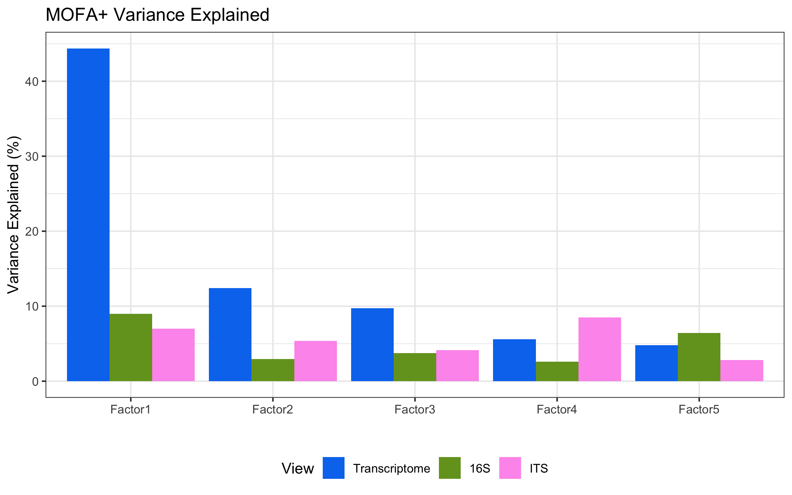

***Figure 5A.** MOFA+ variance explained per factor per view (transcriptome, 16S, ITS).*

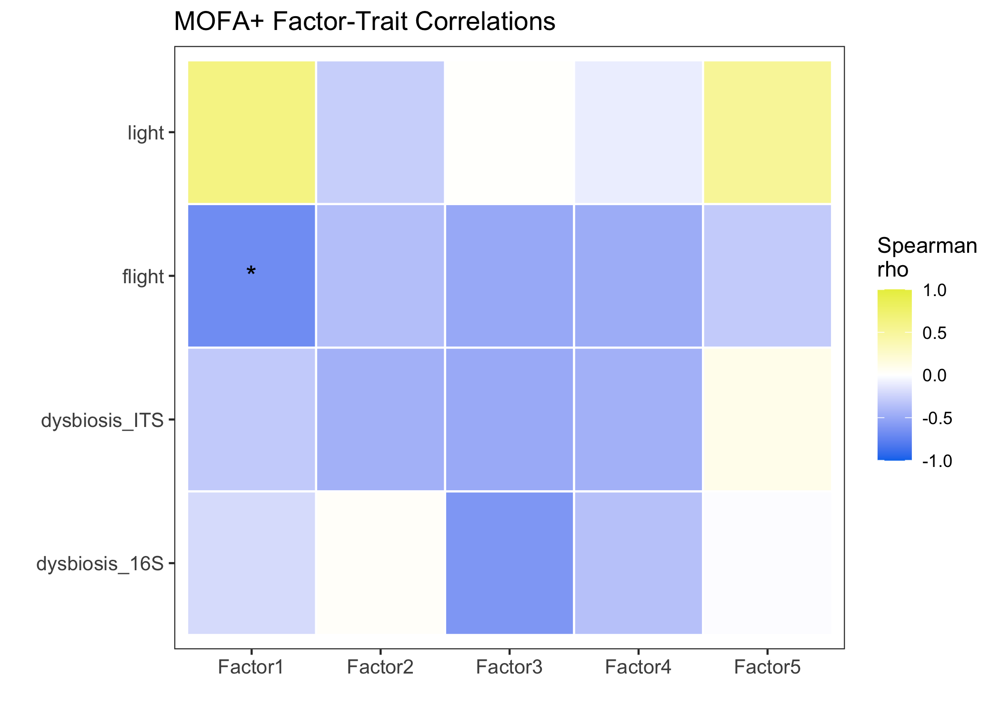

***Figure 5B.** MOFA+ factor–trait correlations; Factor 1 captures flight (ρ=−0.76).*

### Module-taxon correlations link host modules to specific bacteria

Bipartite correlation networks identified 29 significant module-taxon relationships (BH padj < 0.05), predominantly in leaf 16S (28 of 29; Fig. 6; Table S9). The flight-associated turquoise module positively correlated with *Methylobacterium-Methylorubrum* (ρ=+0.76, padj=0.003), *Burkholderia-Caballeronia-Paraburkholderia* (ρ=+0.74, padj=0.003), and *Azospirillum* (ρ=+0.68, padj=0.012) — all genera associated with plant growth promotion and nitrogen fixation. The anti-correlated blue module showed the inverse pattern with these same taxa. The brown module correlated negatively with *Pantoea* (ρ=−0.79, padj=0.003) and *Paenibacillus* (ρ=−0.77, padj=0.003).

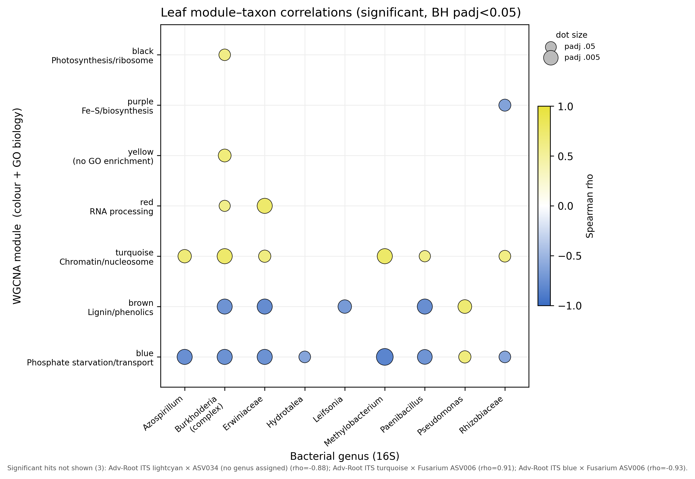

***Figure 6.** Significant leaf module–taxon correlations (BH padj<0.05); modules carry their GO-biology labels (Table 1). The flight-associated turquoise (chromatin/nucleosome) module positively tracks Methylobacterium, Burkholderia and Azospirillum, while the blue (phosphate-starvation) module shows the inverse.*

### Predicted bacterial functions

FAPROTAX assigned bacterial ASVs to 26 functional categories (Table S6). By read count the largest were aerobic chemoheterotrophy (787,792 reads, 185 taxa), nitrogen fixation (164,614 reads, 12 taxa), dark hydrogen oxidation (103,694 reads, 20 taxa), methanol oxidation (96,687 reads, 15 taxa) and methanotrophy (96,514 reads, 15 taxa) (Fig. 7). The methanol oxidation and methanotrophy assignments were primarily *Methylobacterium-Methylorubrum*, the same genus showing the strongest positive correlation with the flight-associated WGCNA module **[TODO: the FAPROTAX collapse misparses three database lines, moving 31 ASVs into spurious categories, and matches taxon names as substrings (*Methylobacterium* is a methylotroph, not a methanotroph); re-run with a corrected parser]**.

Fungal guild assignment (manual genus-level classification) identified saprotrophs (11 ASVs, dominated by *Penicillium* and *Aspergillus*) and plant pathogens (2 ASVs: *Fusarium* spp.) as the main ecological guilds (Table S7).

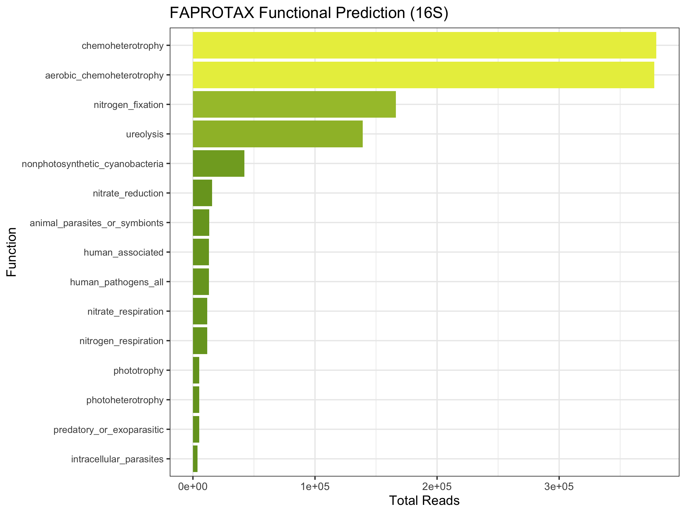

***Figure 7.** FAPROTAX predicted bacterial functions (aerobic chemoheterotrophy, N fixation, methanotrophy, methanol oxidation).*

---

## Discussion

This study presents the first integrated multi-omics analysis of plant-microbiome interactions in the ISS VEG-05 experiment. Our findings reveal three key insights: (1) spaceflight restructures leaf bacterial communities more than fungal communities, with increased alpha diversity in flight; (2) the host transcriptional response to spaceflight is strongly light-dependent, particularly in leaves; and (3) a subset of host genes responds to microbial community changes independently of the direct spaceflight stimulus, providing evidence for microbe-driven host regulation.

The increased bacterial alpha diversity in flight leaves was initially counterintuitive, as spaceflight is often associated with reduced microbial diversity in human microbiome studies [21]. However, in the phyllosphere, the reduced gravity environment may alter leaf surface properties and nutrient availability, potentially creating more ecological niches. The strong correlation between the flight-associated WGCNA module and plant growth-promoting bacteria (*Methylobacterium*, *Burkholderia*, *Azospirillum*) suggests that spaceflight may favor these beneficial taxa, though the directionality of this association (whether the host selects for these bacteria or the bacteria facilitate host adaptation) requires further investigation.

The light-dependent transcriptional response is a novel finding with practical implications for space crop production. The 9-fold difference in DEG counts between blue and red light conditions (4,716 vs. 523) suggests that blue light may amplify the plant's perception of or response to the spaceflight environment. Blue light is known to activate cryptochrome photoreceptors and downstream stress signaling pathways [22], which may interact with spaceflight-induced oxidative stress.

The identification of a microbe-driven WGCNA module in adventitious roots (black module, 169 genes) is perhaps the most significant finding. This module's strong correlation with fungal dysbiosis (r=−0.85) but not with flight status (r=−0.38, padj=0.32) indicates that the host transcriptional response in this module is driven by microbial community changes rather than directly by the spaceflight environment. Although the black module's own GO enrichment was limited (its only enriched term was "nucleus"), the broader adventitious-root oxidative-stress program — concentrated in the larger turquoise module — together with the black module's tight coupling to fungal dysbiosis suggests that fungal community restructuring may trigger host defense and redox responses, potentially through oxidative burst signaling.

### Relationship to a cross-mission salicylic-acid integration

These microbiome findings dovetail with a companion cross-mission analysis that integrated the same OSD-767 transcriptome with an Advanced Plant Habitat experiment manipulating salicylic-acid (SA) signalling (wild-type MoneyMaker versus the SA-deficient *NahG* line). That analysis concluded that the spaceflight transcriptome resembles an SA-deficient, biotic-defense-primed state. Our results offer a proximal explanation: spaceflight-induced dysbiosis — and the microbe-driven, flight-independent host module identified here — could be the stimulus that elicits that defense-primed signature, with SA acting as the gating regulator of plant biotic immunity. Reassuringly, both analyses independently recover the blue-light amplification of the spaceflight response (here, 4,716 versus 523 leaf DEGs; there, a blue-LED-amplified biotic/hormone stress axis) despite using different pipelines. This also rationalises why gene-level spaceflight signatures replicate poorly across missions while the biotic-defense *pattern* is conserved: if that pattern tracks the mission-variable microbiome rather than a fixed microgravity program, pattern-level conservation alongside gene-level divergence is exactly what one expects. A full comparison is provided in `COMPARISON_with_SA_integration.md`.

### Limitations

Several limitations should be noted. First, sample sizes are small (n=21 leaf, n=15 root for RNA-seq; n=1–6 per flight × light group for microbiome), limiting statistical power. Second, 16S leaf samples had very low bacterial read counts after host DNA removal (median 89 reads), precluding rarefaction and requiring reliance on relative abundance metrics. Third, the ITS dataset had uneven group representation, with some flight groups containing only 1–2 samples. Fourth, MOFA+ warned that Factor 1 may partially capture technical variation (detection rate differences), though the strong biological signal supports its interpretation as a flight factor. Fifth, FAPROTAX functional predictions are based on taxonomy and should be validated with metagenomic or metatranscriptomic data. Sixth, the FUNGuild analysis used manual genus-level assignment rather than the full database, reducing assignment confidence. Finally, this study is correlational; causal relationships between host transcription and microbiome changes require experimental validation, ideally in simulated microgravity conditions with microbiome manipulation.

---

---

## Figure legends

- **Figure 1. Study design and analysis overview.** The ISS VEG-05 experiment (tomato cv. Red Robin; Flight vs Ground; red-rich vs blue-rich LED; leaf and adventitious root) feeds two data streams — host transcriptome (OSD-767) and microbiome (OSD-766) — that are combined through DESeq2, WGCNA, a dysbiosis index, MOFA+, and module–taxon networks.
- **Figure 2A.** Bacterial (16S) alpha diversity (Observed ASVs) by flight status and light treatment; flight leaves show higher diversity.
- **Figure 2B (16S).** Bacterial dysbiosis index (mean Bray-Curtis distance to ground samples, relative to ground-ground distance); elevated under flight.
- **Figure 2B (ITS).** Fungal dysbiosis index; the largest displacement is in flight leaves.
- **Figure 3.** DEG summary across tissue × contrast; the leaf blue-light flight response (4,716 DEGs) dwarfs red (523).
- **Figure 3B.** Leaf Flight-vs-Ground volcano (flight main effect of the flight × light model: the flight effect averaged over the two light treatments).
- **Figure 3C.** Adventitious-root Flight-vs-Ground volcano (flight main effect, averaged over the two light treatments; predominantly upregulation).
- **Figure 4 (Leaf).** WGCNA module–trait correlations (flight, light, 16S/ITS dysbiosis). Each module is labelled with its dominant GO biology (Table 1); cells show Pearson r with significance stars.
- **Figure 4 (Adv-Root).** Module–trait correlations with GO-biology labels (Table 1). The black (nucleus) module tracks ITS dysbiosis (r=−0.85) but not flight; the turquoise (oxidative-stress/peroxidase) module is the largest flight-correlated module.
- **Figure 5A.** MOFA+ variance explained per factor per view (transcriptome, 16S, ITS).
- **Figure 5B.** MOFA+ factor–trait correlations; Factor 1 captures flight (ρ=−0.76).
- **Figure 6.** Significant leaf module–taxon correlations (BH padj<0.05); modules carry their GO-biology labels (Table 1). The flight-associated turquoise (chromatin/nucleosome) module positively tracks Methylobacterium, Burkholderia and Azospirillum, while the blue (phosphate-starvation) module shows the inverse.
- **Figure 7.** FAPROTAX predicted bacterial functions (aerobic chemoheterotrophy, N fixation, methanotrophy, methanol oxidation).

---

## Acknowledgements

This work used data from NASA's Open Science Data Repository (OSD-766, OSD-767) generated by the VEG-05 experiment team. We thank the ISS crew and ground support teams for sample collection and the GeneLab community for data processing.

---

## References

[1] Bulgarelli, D. et al. Structure and functions of the bacterial microbiota of plants. *Annu. Rev. Plant Biol.* 64, 807–838 (2013).
[2] TODO: citation needed. The reference previously listed here (Wheeler, R.M. et al., *Adv. Space Res.* 41, 1057–1066, 2008) matches no published record.
[3] Spern, C.J. et al. The microbial communities of a tomato crop grown in Veggie under different lighting regimes on the International Space Station. *Life Sci. Space Res.* 52, 84–97 (2026).
[4] TODO: citation needed. The reference previously listed here (Rosenzweig, J.A. et al., *npj Microgravity* 1, 15009, 2015) matches no published record.
[5] TODO: citation needed. The reference previously listed here (Voorhies, A.A. et al., *PLoS ONE* 14, e0224893, 2019) matches no published record.
[6] Argelaguet, R. et al. MOFA+: a statistical framework for comprehensive integration of multi-modal single-cell data. *Genome Biol.* 21, 111 (2020).
[7] Langfelder, P. & Horvath, S. WGCNA: an R package for weighted correlation network analysis. *BMC Bioinformatics* 9, 559 (2008).
[8] Callahan, B.J. et al. DADA2: High-resolution sample inference from Illumina amplicon data. *Nat. Methods* 13, 581–583 (2016).
[9] Quast, C. et al. The SILVA ribosomal RNA gene database project: improved data processing and web-based tools. *Nucleic Acids Res.* 41, D590–D596 (2013).
[10] Martin, M. Cutadapt removes adapter sequences from high-throughput sequencing reads. *EMBnet.journal* 17, 10–12 (2011).
[11] Kõljalg, U. et al. UNITE: a database providing web-based methods for the molecular identification of ectomycorrhizal fungi. *New Phytol.* 166, 1063–1068 (2005).
[12] Love, M.I. et al. Moderated estimation of fold change and dispersion for RNA-seq data with DESeq2. *Genome Biol.* 15, 550 (2014).
[13] Zhu, A., Ibrahim, J.G. & Love, M.I. Heavy-tailed prior distributions for sequence count data: removing the noise and preserving large differences. *Bioinformatics* 35, 2084–2092 (2019).
[14] Stephens, M. False discovery rates: a new deal. *Biostatistics* 18, 275–294 (2017).
[15] McMurdie, P.J. & Holmes, S. phyloseq: an R package for reproducible interactive analysis and graphics of microbiome census data. *PLoS ONE* 8, e61217 (2013).
[16] Oksanen, J. et al. vegan: Community Ecology Package. R package version 2.7-5 (2026).
[17] Fernandes, A.D. et al. Unifying the analysis of high-throughput sequencing datasets: characterizing RNA-seq, 16S rRNA gene sequencing and selective growth experiments by compositional data analysis. *Microbiome* 2, 15 (2014).
[18] Yu, G. et al. clusterProfiler: an R package for comparing biological themes among gene clusters. *OMICS* 16, 284–287 (2012).
[19] Louca, S., Parfrey, L.W. & Doebeli, M. Decoupling function and taxonomy in the global ocean microbiome. *Science* 353, 1272–1277 (2016).
[20] Nguyen, N.H. et al. FUNGuild: an open annotation tool for parsing fungal community datasets by ecological guild. *Fungal Ecol.* 20, 241–248 (2016).
[21] Voorhies, A.A. et al. Study of the impact of long-duration space missions at the International Space Station on the astronaut microbiome. *Sci. Rep.* 9, 9911 (2019).
[22] Chaves, I. et al. The cryptochromes: blue light photoreceptors in plants and animals. *Annu. Rev. Plant Biol.* 62, 335–364 (2011).
[23] Dixit, A.R. et al. Stress and light spectral quality influence the transcriptome of a tomato crop on the International Space Station. *BMC Plant Biol.* 26, 764 (2026).
